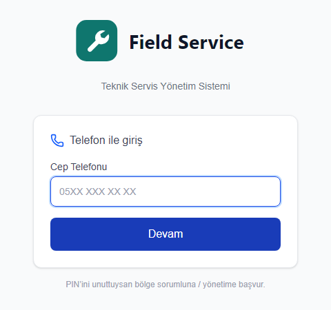
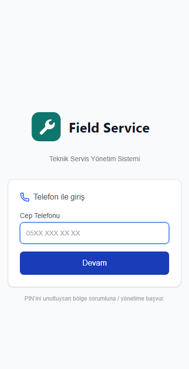

# SAP Field Service Management

**English** | [Türkçe](README.tr.md)

> **Enterprise Showcase Repository:** A modern Progressive Web App (PWA) built for field service operations directly integrated with **SAP Business One HANA / SQL**. Technicians handle work orders, issue spare parts from warehouse stock, track equipment serial numbers, and capture digital customer signatures on-site. Source code is kept private in an enterprise repository.

---

## 📱 Interface Preview

| Desktop / Tablet View | Mobile PWA View |
|:---:|:---:|
|  |  |
| *Desktop dispatcher & management portal* | *Mobile field technician execution UI* |

---

## 🏗️ Architecture & SAP Service Layer Flow

`mermaid
flowchart TD
    subgraph Client ["Client Layer (PWA)"]
        TechMobile["📱 Field Technician (Mobile PWA)"]
        ManagerWeb["💻 Service Coordinator & Dispatcher"]
    end

    subgraph AppLayer ["Application Layer (Next.js 16 + React 19)"]
        NextServer["Next.js Server Actions & API Routes"]
        AuthModule["JWT + PIN Auth & Role Guard"]
        OfflineSync["Service Worker & Offline Cache"]
        DocEngine["PDF (pdf-lib) & ExcelJS Engine"]
    end

    subgraph SAPLayer ["SAP Business One ERP"]
        ServiceLayer["SAP B1 Service Layer (OData / REST)"]
        SAPServiceCalls["Service Calls (OSCL) & Activities"]
        SAPInventory["Warehouse & Spare Parts (OITM / OWHS)"]
        SAPEquipment["Customer Equipment Cards (OINS)"]
        SAPOrders["Sales Orders & Drafts (ORDR)"]
    end

    TechMobile -->|HTTPS / Offline First| OfflineSync
    OfflineSync --> NextServer
    ManagerWeb --> NextServer
    NextServer --> AuthModule
    AuthModule --> ServiceLayer
    NextServer --> DocEngine
    ServiceLayer --> SAPServiceCalls
    ServiceLayer --> SAPInventory
    ServiceLayer --> SAPEquipment
    ServiceLayer --> SAPOrders
`

---

## ⚡ Core Capabilities

- **Field Service Call Management:** Real-time synchronization with SAP B1 Service Calls (OSCL). Full support for call status progression, problem diagnosis codes, and technician assignment.
- **On-Site Equipment Inspection:** Direct association with Customer Equipment Cards (OINS) by serial number, warranty verification, and historical service logs.
- **Warehouse & Spare Parts Tracking:** Instant parts requisition from designated mobile/warehouse bins, price list lookup, and automated Sales Order / Delivery generation in SAP B1.
- **Digital Signatures & Instant PDF Service Slips:** On-screen customer acceptance capture using HTML5 canvas, generating instant single-page printable PDF service reports (pdf-lib).
- **Weekly Dispatcher & Scheduling Calendar:** Drag-and-drop technician assignment, route optimization, and live status boards for service managers.
- **Performance & Time Tracking:** Detailed technician timesheets, labor hours tracking, overtime approvals, and automated monthly Excel reporting.
- **PIN-Based Quick Authentication:** Secure 4-digit PIN + mobile number authentication mapped to SAP B1 Employee master data with stateless JWT tokens.

---

## 🛠️ Technology Stack

| Layer | Technologies |
|:---|:---|
| **Frontend** | Next.js 16 (App Router), React 19, TypeScript, Tailwind CSS 4, PWA Service Workers |
| **Backend / API** | Next.js Server Components / Actions, RESTful Service Layer Integration |
| **Enterprise ERP** | SAP Business One (HANA / SQL) Service Layer API (v2) |
| **Document & Signature** | pdf-lib (Service Slip generation), exceljs (Timesheets), 
eact-signature-canvas |
| **Data Visualization** | 
echarts (Technician KPI & SLA metrics) |
| **Security** | JWT session tokens, bcrypt PIN hashing, SAP B1 role-based access control |

---

> 🔒 *Note: This repository is a technical showcase and architecture portfolio. The proprietary production codebase and enterprise connection parameters are maintained in a private repository.*