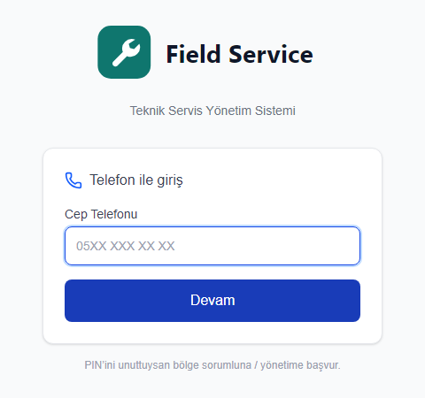
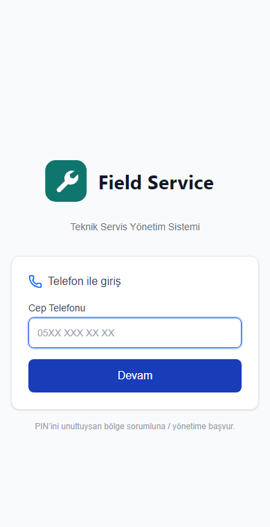
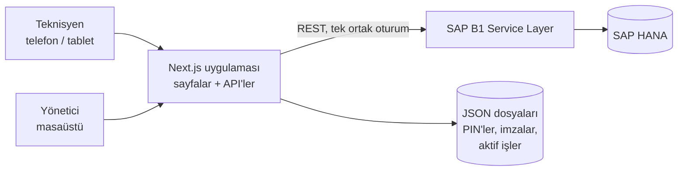

# SAP Saha Servis

[English](README.md) | **Türkçe**

SAP Business One üzerinde çalışan, saha servis ekipleri için bir web uygulaması. Teknisyenler
servis kayıtlarını telefonlarından açar, günceller ve kapatır; kullandıkları parçaları girer ve
müşterinin imzasını ekranda alır. Yöneticiler haftayı planlar ve raporları görür. Tüm veri SAP'de
kalır; uygulama SAP ile Service Layer API üzerinden konuşur. Gerçek bir firma için yapıldı; bu
kopyada isimler ve ayarlar örnek değerlerle değiştirildi.

| Telefon ve PIN ile giriş | Telefonda |
|---|---|
|  |  |

## Özellikler

- **Servis kayıtları:** SAP servis çağrılarını aç, güncelle, kapat; servis ve arıza tipleri SAP'den
  gelir; geçmiş, yapılan işler ve masraflar tek ekranda.
- **Planlama:** bir ya da birden çok teknisyen ata, haftayı takvimde planla.
- **Parça ve stok:** SAP stoğundan yedek parça çıkışı, satış siparişi oluşturma ve onaylama, canlı
  fiyatlarla.
- **Müşteri ekipmanı:** müşterinin makinesini (seri no, model) servis kaydına bağla.
- **İmza ve yazdırma:** müşteri ve teknisyen ekranda imzalar; servis formu tüm ayrıntılarla tek
  sayfa basılır.
- **Raporlar:** teknisyen performansı, Excel'e aktarılabilen haftalık çalışma çizelgesi, aylık
  özet, fazla mesai onayı.
- **Roller:** teknisyen, bölge sorumlusu, yönetim ve sipariş yönetimi; çalışanın SAP kaydından gelir.
- **Giriş:** telefon numarası ve ilk girişte belirlenen 4 haneli PIN; JWT oturumları.
- **Telefonda çalışır:** Progressive Web App olarak.

## Teknolojiler

Next.js 16 (App Router), React 19, TypeScript, Tailwind CSS 4, SAP Business One Service Layer,
JWT ve bcrypt, ExcelJS, pdf-lib, Recharts, react-signature-canvas.

> Bu depo projeyi tanıtır. Kaynak kodu özel (private) bir depoda tutulur.
